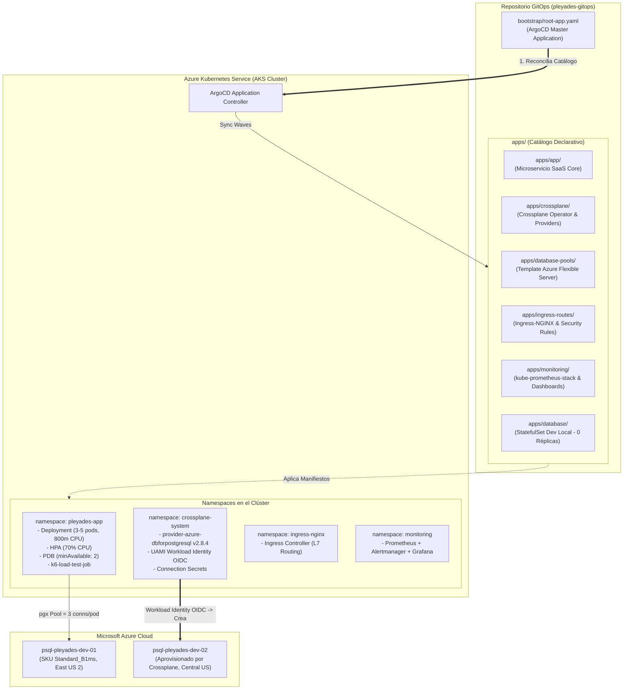
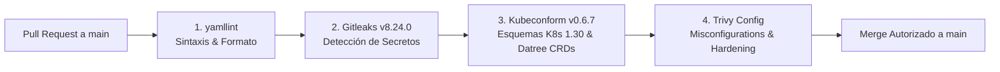

# 🌌 Proyecto Pléyades — Platform GitOps & SRE Control Plane

[](https://argoproj.github.io/cd/)
[](https://crossplane.io/)
[](https://prometheus.io/)
[](https://grafana.com/)
[](https://cilium.io/)
[](https://github.com/features/actions)
[](https://trunkbaseddevelopment.com/)

El **cerebro declarativo y plano de control** de la plataforma **Pléyades**. Este repositorio constituye la **Fuente Única de Verdad (Single Source of Truth)** para todo lo que vive, escala y opera dentro del clúster de Kubernetes gestionado (**Azure Kubernetes Service - AKS**). 

Bajo la filosofía **GitOps Pull-Based**, ningún operador ni pipeline de CI interactúa directamente con la API de Kubernetes para aplicar cambios de infraestructura o despliegue. **ArgoCD** observa continuamente este repositorio en la rama `main` y reconcilia de manera autónoma el estado deseado frente al clúster vivo en Microsoft Azure, garantizando auto-reparación continua (*Self-Healing*) y detección de desviaciones (*Drift Detection*).

---

## 🏛️ 1. Misión y Responsabilidad del Repositorio

| Responsabilidad | Implementación Técnica en este Repositorio |
| :--- | :--- |
| **Gobernanza GitOps (App-of-Apps)** | Orquestación centralizada de todos los componentes de la plataforma mediante la aplicación raíz `bootstrap/root-app.yaml`. |
| **Cloud Control Plane (IDP)** | Operadores modulares de **Upbound Crossplane** (`apps/crossplane/`) para permitir que la plataforma y la aplicación aprovisionen servidores de bases de datos relacionales en Azure mediante Custom Resources YAML sin tocar el portal web ni Terraform. |
| **Protección y Gobernanza SRE** | Definición estricta de políticas de resiliencia: **HorizontalPodAutoscaler (HPA)**, **PodDisruptionBudget (PDB)**, cuotas de recursos CFS (`limits.cpu: 800m`), y estrategias de despliegue rodante (*RollingUpdate* sin indisponibilidad). |
| **Sincronización de Capacidad de BD** | Inyección de variables de entorno de conexión (`DB_MAX_OPEN_CONNS=3`) acopladas matemáticamente a los límites del SKU B1ms de Azure PostgreSQL Flexible Server y cuotas por inquilino. |
| **Suite de Carga In-Cluster (SRE)** | Arnés de pruebas de rendimiento con **k6** (`apps/app/k6-load-test-job.yaml`) ejecutado dentro del clúster AKS contra el ClusterIP para evaluar los SLOs de negocio sin cuellos de botella de red perimetral. |
| **Seguridad de Red y Perímetro** | Enrutamiento eBPF L4/L7 mediante **Cilium KPR** y gobierno declarativo de Ingress (ADR 36: rutas HTTP planas deshabilitadas para impedir transmisión de credenciales y JWT sin TLS). |
| **Observabilidad y Golden Signals** | Despliegue de `kube-prometheus-stack` con Server-Side Apply para monitorear latencias, tasas de peticiones, saturación de CPU y saturación de conexiones. |

---

## 📐 2. Arquitectura de Despliegue: Patrón App-of-Apps

La plataforma adopta el estándar **App-of-Apps** de ArgoCD, donde una aplicación madre (`bootstrap/root-app.yaml`) gobierna y sincroniza un catálogo desacoplado de sub-aplicaciones ubicadas en `apps/`:



---

## 📂 3. Estructura y Componentes del Repositorio

```text
pleyades-gitops/
├── .github/
│   └── workflows/
│       └── ci.yml                    # Pipeline DevSecOps: Yamllint, Gitleaks, Kubeconform y Trivy
├── .yamllint.yml                     # Reglas estrictas de sintaxis y formato YAML
│
├── bootstrap/
│   └── root-app.yaml                 # Aplicación Raíz que orquesta todo el patrón App-of-Apps
│
├── apps/                             # Catálogo de aplicaciones gestionadas por ArgoCD
│   ├── app/                          # Carga de trabajo core de producción (pleyades-app)
│   │   ├── configmap.yaml            # Variables de entorno: DB_MAX_OPEN_CONNS=3, DB_MAX_IDLE_CONNS=3
│   │   ├── deployment.yaml           # Deployment: requests 100m, limits 800m, RollingUpdate surge
│   │   ├── hpa.yaml                  # HorizontalPodAutoscaler: min 3, max 5, umbral 70% CPU
│   │   ├── pdb.yaml                  # PodDisruptionBudget: minAvailable 2
│   │   ├── k6-load-test-job.yaml     # Kubernetes Job in-cluster con grafana/k6:0.56.0
│   │   ├── kustomization.yaml        # Kustomize manifest para agregación del microservicio
│   │   ├── namespace.yaml            # Namespace dedicado 'pleyades-app'
│   │   ├── rbac.yaml                 # RBAC de mínimo privilegio: ClusterRole para CRDs Crossplane
│   │   ├── service.yaml              # ClusterIP Service (puerto 8080)
│   │   └── servicemonitor.yaml       # Mapeo de métricas para scraping de Prometheus
│   │
│   ├── crossplane/                   # Plano de control de infraestructura cloud
│   │   ├── deployment-runtime-config.yaml # Mutación de Workload Identity OIDC y límites de recursos
│   │   ├── provider-azure-dbforpostgresql.yaml # Upbound Azure PostgreSQL Provider (v2.8.4)
│   │   ├── provider-azure-storage.yaml    # Upbound Azure Storage Provider (v2.8.4)
│   │   ├── provider-config.yaml           # ProviderConfig vinculado a la Managed Identity de Azure
│   │   ├── provider-family-azure.yaml     # Upbound Family Azure Provider
│   │   └── kustomization.yaml             # Kustomize agregador de operadores Crossplane
│   │
│   ├── database-pools/               # Catálogo de plantillas para auto-escalado horizontal de BD
│   │   ├── template-flexible-server.yaml  # Plantilla Custom Resource de Azure Flexible Server
│   │   └── kustomization.yaml
│   │
│   ├── ingress-routes/               # Reglas de enrutamiento perimetral Ingress-NGINX
│   │   ├── app-ingress.yaml          # Ingress del microservicio core
│   │   ├── argo-ingress.yaml         # Ingress de la consola web de ArgoCD
│   │   ├── grafana-ingress.yaml      # Ingress de dashboards de Grafana
│   │   └── kustomization.yaml        # ADR 36: Rutas HTTP planas comentadas/deshabilitadas por seguridad
│   │
│   ├── monitoring/                   # Stack de Observabilidad SRE
│   │   └── README.md                 # Documentación del stack Prometheus/Grafana con Server-Side Apply
│   │
│   └── database/                     # PostgreSQL StatefulSet in-cluster (managed-csi)
│       └── postgres-statefulset.yaml # Retirado en AKS (ADR 10 vs 30): réplicas=0, preservado para dev local
│
└── README.md                         # Documentación maestra del plano de control GitOps
```

---

## 🎯 4. Decisiones Técnicas Críticas Encarnadas en GitOps

Toda configuración en este repositorio responde a una justificación arquitectónica rigurosa respaldada por el **Registro de Decisiones de Arquitectura (ADRs)** del proyecto:

### 1. Dimensionamiento del Connection Pool: `DB_MAX_OPEN_CONNS=3` (ADR 14 y ADR 37)
* **Archivo:** `apps/app/configmap.yaml` ([PR #32](https://github.com/lopezzuluagaj3-collab/pleyades-gitops/pull/32) y [PR #33](https://github.com/lopezzuluagaj3-collab/pleyades-gitops/pull/33))
* **Contexto de Capacidad en Azure:**
  * Servidor Azure PostgreSQL Flexible Server (`Standard_B1ms` con 2 GiB RAM): `max_connections = 50`.
  * Reservas del sistema medidas en Azure CLI: 10 superuser + 5 replication = **15 reservadas**.
  * **Conexiones efectivas utilizables:** $50 - 15 = \mathbf{35\text{ conexiones}}$.
  * Cuota reservada para 7 inquilinos (ADR 31): $7 \times 2\text{ conns} = \mathbf{14\text{ conexiones}}$ fijadas mediante `ALTER ROLE ... CONNECTION LIMIT 2;`.
  * **Presupuesto restante para la aplicación:** $35 - 14 = \mathbf{21\text{ conexiones}}$.
* **Aritmética Defensiva del Pool:**
  * Carga nominal (3 pods): $3 \times 3 = 9\text{ conns}$ ($9 + 14 = 23 \implies \mathbf{12\text{ slots libres / 34.3\% margen}}$).
  * Pico elástico HPA (5 pods): $5 \times 3 = 15\text{ conns}$ ($15 + 14 = 29 \implies \mathbf{6\text{ slots libres / 17.1\% margen}}$).
  * RollingUpdate en pico (6 pods transitorios con `maxSurge: 1`): $6 \times 3 = 18\text{ conns}$ ($18 + 14 = \mathbf{32\text{ conexiones}}$ sobre 35 utilizables).
  * **Margen Permanente Garantizado:** **3 slots libres permanentes (8.5%)**, eliminando cualquier riesgo de saturación de sockets en PostgreSQL.
  * *Por qué prevalece sobre el valor histórico 4:* Con 4 conexiones por pod, un RollingUpdate bajo pico consumía $6 \times 4 + 14 = 38 > 35$, provocando rechazos de conexión inmediatos (`too many clients already`).

### 2. Capacidad de Cómputo CPU: `limits.cpu: 800m` y Desbloqueo del SLO (ADR 22 y ADR 37)
* **Archivo:** `apps/app/deployment.yaml` ([PR #34](https://github.com/lopezzuluagaj3-collab/pleyades-gitops/pull/34))
* **Problema Resuelto (CFS Throttling):**
  * La derivación de contraseñas Bcrypt (`cost=10`) exige estrictamente **~70ms de tiempo puro de CPU**.
  * Con los límites previos de `500m` ([PR #30](https://github.com/lopezzuluagaj3-collab/pleyades-gitops/pull/30)), 5 réplicas del HPA quedaban topadas artificialmente por el kernel de Linux a $5 \times 0.5 = 2.5\text{ vCPUs}$ máximas ($\approx 35.7\text{ hashes/s}$), haciendo físicamente imposible alcanzar el SLO de $p95 < 1500\text{ ms}$ a 50 VUs (tiempo medio en cola por Ley de Little: $W = \frac{50}{35.7} - 0.1 = 1.30\text{ s}$).
* **Solución Implementada:**
  * Se configuraron `requests.cpu: 100m` y `limits.cpu: 800m`.
  * Con 5 pods en 2 nodos `Standard_D2s_v7` (3 pods en Nodo A y 2 en Nodo B), descontando el consumo de plataforma (Cilium, ArgoCD, Crossplane, Stack SRE: 0.4–0.6 vCPUs), la aplicación dispone de **3.0 a 3.2 vCPUs útiles reales** ($\approx 43\text{ a }46\text{ hashes/s}$).
  * **Ley de Little ($W = \frac{L}{\lambda} - Z$):**
    $$W = \frac{50\text{ VUs}}{43\text{ req/s}} - 0.1\text{ s} = \mathbf{1.06\text{ segundos en cola}} \implies \text{Latencia Media } T \approx 1.16\text{ s} \implies \mathbf{p95 < 1500\text{ ms}}$$
  * Se sostiene sólidamente el SLO de negocio sin necesidad de aumentar réplicas ni sobrecargar el pool de base de datos.

### 3. Elasticidad y Resiliencia Cloud-Native: HPA, PDB y RollingUpdate (ADR 37)
* **HorizontalPodAutoscaler (`apps/app/hpa.yaml`):**
  * Rango elástico de **mínimo 3 y máximo 5 réplicas** con umbral al **70% de CPU** sobre `requests.cpu: 100m` (umbral: 70m por pod). Como un hash de Bcrypt consume ~70m por segundo, una sola petición sostenida por segundo activa el escalado inmediato hacia 5 réplicas.
* **PodDisruptionBudget (`apps/app/pdb.yaml`):**
  * Política estricta con **`minAvailable: 2`**. Durante operaciones de mantenimiento voluntario (`kubectl drain`, upgrades de versión de AKS), Kubernetes garantiza que la aplicación mantenga en todo momento al menos 2 pods saludables.
* **Estrategia RollingUpdate (`apps/app/deployment.yaml`):**
  * `maxSurge: 1` y `maxUnavailable: 0`: Se levanta un nuevo pod y se valida su `readinessProbe` antes de dar de baja el pod antiguo, garantizando **cero tiempo de inactividad (*Zero Downtime*)**.

### 4. Gobernanza del Cluster Autoscaler y Cuota Regional (ADR 06 y ADR 37)
* **Mecánica del Cluster Autoscaler:** El Cluster Autoscaler de Kubernetes solo reacciona ante pods en estado `Pending (Unschedulable)` al no caber sus `requests`. Con `requests.cpu: 100m`, 5 pods solo solicitan 500m, lo que cabe cómodamente en 1 solo nodo junto a plataforma (~1400m $\le$ 1800m). Por ende, el CA nunca levantaría el 2.º nodo de forma dinámica.
* **Decisión en Producción:** La infraestructura opera con **`min_count = 2`** en el node pool de AKS (`modules/aks` / ADR 06). Esto elimina los 90–120 segundos de arranque en frío de VMs en Azure que destruirían el SLO durante un pico de tráfico.
* **Condición de Upgrades `maxSurge: 0`:** Con una cuota regional de 4 vCPUs (máximo 2 nodos `Standard_D2s_v7`), la actualización in-place con `maxSurge: 0` es viable **únicamente si ya existen 2 nodos activos**, permitiendo evacuar los pods del Nodo A al Nodo B respetando el PDB. En 1 solo nodo, `maxSurge: 0` causaría un deadlock contra el PDB (`minAvailable: 2`).

### 5. Seguridad Perimetral: Deshabilitación de Ingress HTTP Plano (ADR 35 vs ADR 36)
* **Archivo:** `apps/ingress-routes/kustomization.yaml` ([PR #27](https://github.com/lopezzuluagaj3-collab/pleyades-gitops/pull/27))
* **Prevalencia de ADR 36:** Para mitigar el hallazgo de seguridad crítico `SEC-06` (transmisión de contraseñas de login, tokens JWT y contraseñas de tenants por HTTP plano sin cifrar), se deshabilitaron declarativamente las rutas de Ingress público en el archivo `kustomization.yaml`.
* La exposición temporal para pruebas se realiza exclusivamente mediante túneles autenticados con `kubectl port-forward` o ejecuciones in-cluster mediante Kubernetes Jobs hasta la integración formal de TLS con `cert-manager` y Let's Encrypt.

### 6. Suite de Carga In-Cluster con k6 (ADR 22)
* **Archivo:** `apps/app/k6-load-test-job.yaml` ([PR #25](https://github.com/lopezzuluagaj3-collab/pleyades-gitops/pull/25) y [PR #26](https://github.com/lopezzuluagaj3-collab/pleyades-gitops/pull/26))
* Para certificar los SLOs sin el cuello de botella del túnel SPDY de `kubectl port-forward` (que conecta a un solo pod y satura el API Server), se empaquetó un Job nativo con la imagen `grafana/k6:0.56.0` que ataca directamente el ClusterIP interno (`http://pleyades-app-service.pleyades-app.svc.cluster.local:8080`), permitiendo a Cilium eBPF distribuir la carga uniformemente entre todos los pods del Deployment.

---

## 🛡️ 5. Compuertas de Calidad DevSecOps en CI (`.github/workflows/ci.yml`)

Cada Pull Request hacia la rama `main` debe superar obligatoriamente un pipeline automatizado de **4 compuertas de seguridad y validación estructural**:



1. **`yamllint`:** Valida sangrías, saltos de línea y sintaxis limpia conforme a `.yamllint.yml`.
2. **`gitleaks` (v8.24.0):** Escaneo profundo del historial de commits (`--fetch-depth=0`) para impedir que certificados, claves privadas, tokens o contraseñas se filtren en los manifiestos.
3. **`kubeconform` (v0.6.7):** Validación estricta contra la especificación OpenAPI de **Kubernetes v1.30.0** y el catálogo oficial de CRDs de Datree (validando esquemas de Custom Resources de ArgoCD y Crossplane).
4. **`trivy-security`:** Auditoría de seguridad de manifiestos buscando privilegios innecesarios, escalada de privilegios y violaciones de políticas CIS Benchmark.

---

## 🚀 6. Guía de Operaciones y Despliegue (PowerShell)

### Bootstrap Inicial del Clúster
Una vez que el clúster AKS ha sido provisionado por Terraform en `pleyades-infrastructure`:

```powershell
# 1. Obtener credenciales de kubeconfig
az aks get-credentials --resource-group rg-pleyades-dev --name aks-pleyades-dev --overwrite-existing

# 2. Presentar la aplicación madre (Root App) a ArgoCD
kubectl apply -f bootstrap/root-app.yaml

# 3. Verificar el estado de reconciliación de las aplicaciones
kubectl get applications -n argocd
```

### Ejecución de Pruebas de Carga SRE In-Cluster
```powershell
# 1. Lanzar el Job de k6 contra el ClusterIP interno
kubectl apply -f apps/app/k6-load-test-job.yaml -n pleyades-app

# 2. Monitorear los logs en tiempo real y validar latencias p95
kubectl logs -f job/k6-load-test -n pleyades-app
```

### Acceso Administrativo Seguro por Port-Forward
Dado que el Ingress público se encuentra deshabilitado por política de seguridad (ADR 36):

```powershell
# Consola de ArgoCD (acceder en https://localhost:8081)
kubectl port-forward svc/argocd-server -n argocd 8081:443

# Consola de Grafana Dashboards (acceder en http://localhost:3000)
kubectl port-forward svc/kube-prometheus-stack-grafana -n monitoring 3000:80

# API REST del Microservicio Core (acceder en http://localhost:8080)
kubectl port-forward svc/pleyades-app-service -n pleyades-app 8080:8080
```

---

## 🔗 Trazabilidad con otros Repositorios del Ecosistema

* 🏗️ **Infraestructura Base:** [pleyades-infrastructure](https://github.com/lopezzuluagaj3-collab/pleyades-infrastructure) — Terraform modular, AKS con Cilium eBPF, OIDC Entra ID y Blob Storage tfstate.
* ⚡ **Microservicio Core:** [pleyades-app](https://github.com/lopezzuluagaj3-collab/pleyades-app) — Backend Go 1.24, Arquitectura Hexagonal, Multi-Tenancy Sharded Pools, suite k6 y Distroless OCI.
* 📖 **Documentación de Decisiones Arquitectónicas:** Consolidada en el [Registro Maestro de 37 ADRs](https://github.com/lopezzuluagaj3-collab/pleyades-infrastructure) con memoria técnica de cálculo y matriz de deuda técnica.

---

<p align="center">
  <b>Proyecto Pléyades</b> • Diseñado y construido por <b>Juan Diego López Zuluaga</b><br/>
  <i>DevOps, Cloud Platform & SRE Engineer</i>
</p>
