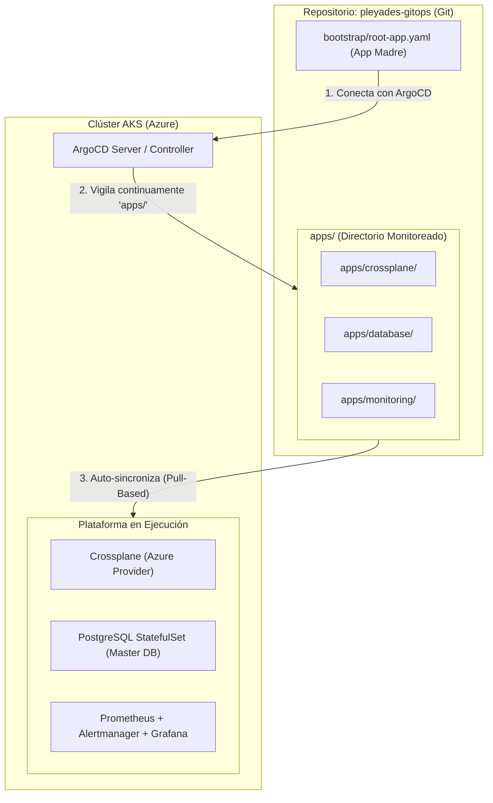

# 🌌 Proyecto Pléyades — Platform GitOps & SRE Control Plane

[](https://argoproj.github.io/cd/)
[](https://crossplane.io/)
[](https://prometheus.io/)
[](https://grafana.com/)
[](https://trunkbaseddevelopment.com/)

El cerebro declarativo de la plataforma **Pléyades**. Todo lo que existe y opera dentro del clúster de Kubernetes (**AKS**) se define aquí mediante manifiestos YAML puros. **ArgoCD** reconcilia continuamente el estado deseado contra el clúster vivo en Microsoft Azure.

---

## 🏛️ Arquitectura del Repositorio (Patrón App-of-Apps)

Este repositorio implementa el estándar **App-of-Apps** de ArgoCD:



---

## 📂 Estructura del Proyecto

```text
pleyades-gitops/
├── bootstrap/                    # Aplicación Raíz que gobierna todo el clúster
│   └── root-app.yaml             # Definición de la Application 'pleyades-root-app'
│
├── apps/                         # Catálogo de componentes gestionados por ArgoCD
│   ├── crossplane/               # Crossplane Operator, Provider Azure y Compositions
│   ├── database/                 # PostgreSQL StatefulSet (Master DB para desarrollo)
│   └── monitoring/               # Stack SRE: Prometheus, Grafana, SLOs y Error Budgets
│
└── README.md                     # Documentación del plano de control GitOps
```

---

## 🚀 ¿Cómo se Inicializa en el Clúster?

Una vez desplegada la infraestructura base con Terraform, solo se requiere presentar la aplicación raíz a ArgoCD una única vez:

```powershell
kubectl apply -f bootstrap/root-app.yaml
```

A partir de ese instante, **ArgoCD asume el control absoluto**: cualquier cambio, adición o eliminación de archivos dentro del directorio `apps/` en la rama `main` se sincroniza automáticamente en el clúster sin intervención humana.

---

<p align="center">
  <b>Proyecto Pléyades</b> • Diseñado y construido por <b>Juan Diego López Zuluaga</b><br/>
  <i>DevOps, Cloud Platform & SRE Engineer</i>
</p>
